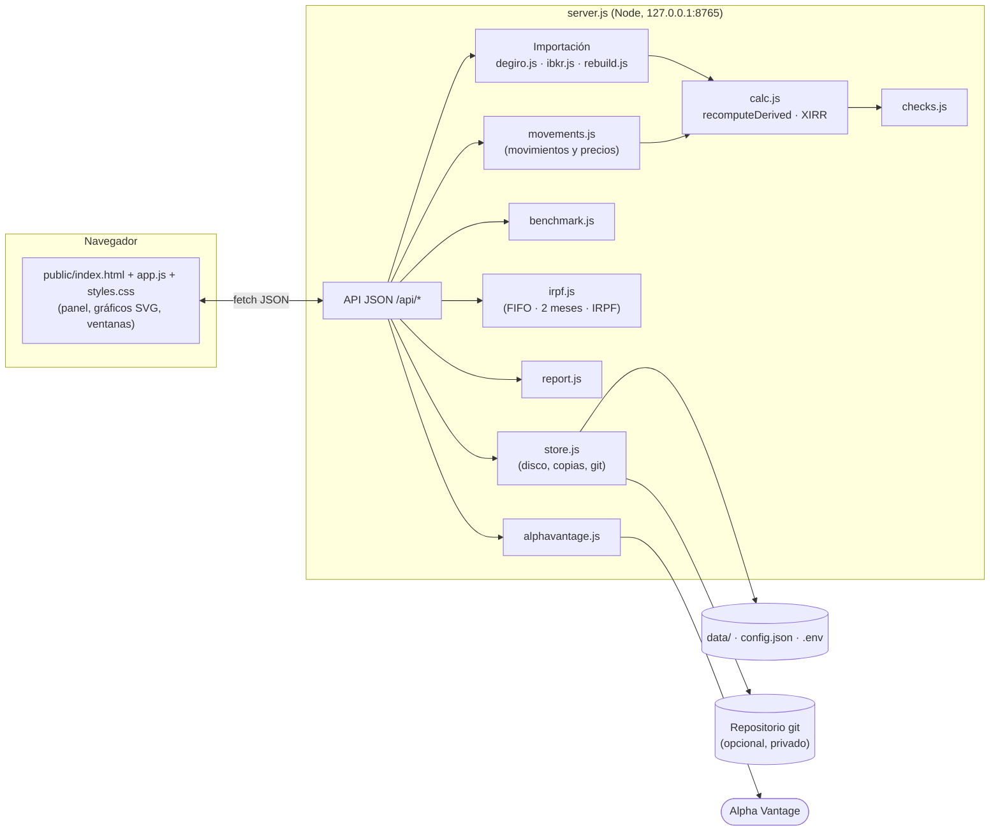
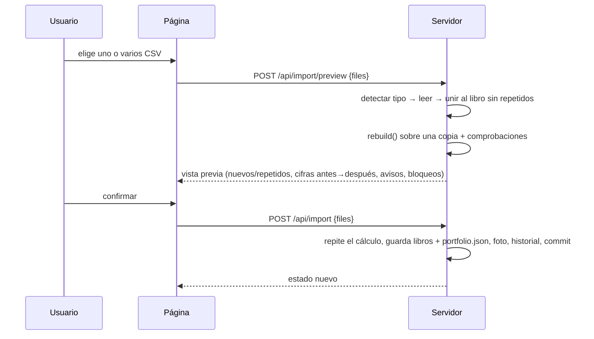

# Panorama de Cartera — documentación técnica

Este documento describe qué hace la aplicación y cómo funciona por dentro: arquitectura, datos, cálculos, importación de extractos, precios, comparación con índices, simulación fiscal del IRPF (España), comprobaciones, guardado y versiones, interfaz, informe exportable y pruebas.

No contiene datos de ninguna cartera concreta: los ejemplos son genéricos.

---

## Índice

1. [Qué es y principios de diseño](#1-qué-es-y-principios-de-diseño)
2. [Arquitectura](#2-arquitectura)
3. [Estructura de archivos](#3-estructura-de-archivos)
4. [Servidor local y seguridad](#4-servidor-local-y-seguridad)
5. [Modelo de datos](#5-modelo-de-datos)
6. [Importación de extractos](#6-importación-de-extractos)
7. [Cálculo de la cartera](#7-cálculo-de-la-cartera)
8. [Movimientos registrados a mano](#8-movimientos-registrados-a-mano)
9. [Precios y tipos de cambio](#9-precios-y-tipos-de-cambio)
10. [Comparación con índices](#10-comparación-con-índices)
11. [Simulación fiscal del IRPF (España)](#11-simulación-fiscal-del-irpf-españa)
12. [Comprobaciones de coherencia](#12-comprobaciones-de-coherencia)
13. [Guardado, copias, deshacer y git](#13-guardado-copias-deshacer-y-git)
14. [Interfaz](#14-interfaz)
15. [Informe exportable](#15-informe-exportable)
16. [API HTTP interna](#16-api-http-interna)
17. [Una sola cuenta, cartera vacía y copia para compartir](#17-una-sola-cuenta-cartera-vacía-y-copia-para-compartir)
18. [Pruebas](#18-pruebas)
19. [Límites conocidos](#19-límites-conocidos)
20. [Registro de cambios](#20-registro-de-cambios)

---

## 1. Qué es y principios de diseño

Panorama de Cartera es un panel personal para seguir una cartera de acciones repartida entre **DEGIRO** e **Interactive Brokers (IBKR)**, o solo en una de las dos. Reúne posiciones, aportaciones, dividendos, comisiones, resultado realizado, rentabilidad (TIR) y una comparación con el S&P 500 y el Nasdaq-100.

Principios:

| Principio | Cómo se cumple |
| --- | --- |
| **Local y privado** | Un servidor Node.js que escucha solo en `127.0.0.1`. Los datos viven en la carpeta de la aplicación; nada sale del ordenador salvo las consultas de cotizaciones a Alpha Vantage (si hay clave) y el `git push` a tu repositorio privado (si lo activas). |
| **Sin dependencias** | Solo Node.js ≥ 18. No hay `node_modules`: HTTP, CSV, XIRR, gráficos SVG y git se hacen con la biblioteca estándar y código propio. |
| **Funciona sin conexión** | Todo se calcula en local. Sin internet solo dejan de funcionar la descarga de precios e índices; los precios se pueden introducir a mano. |
| **Los extractos mandan** | Las cifras se reconstruyen siempre desde los extractos importados (los "libros"), no se acumulan a mano. Reimportar lo mismo no cambia nada. |
| **Todo cuadra o no se guarda** | Antes de guardar se ejecutan ~50 comprobaciones cruzadas; si un cambio rompe alguna, se rechaza. |
| **Nada se pierde** | Cada guardado deja copia del estado anterior (deshacer) y, si la carpeta es un repositorio git, un commit. |

---

## 2. Arquitectura



**Reparto de responsabilidades**

- **El servidor** guarda el estado y hace todos los cálculos, validaciones y escrituras. Es la única pieza que toca el disco, la clave de Alpha Vantage y git.
- **El navegador** solo pinta. Pide `GET /api/portfolio`, recibe los datos ya calculados, las comprobaciones y el estado, y los dibuja. Cuando el usuario cambia algo, envía la petición al servidor y recarga la vista con la respuesta.
- **Los módulos de `lib/`** son funciones puras o casi puras: reciben datos y devuelven datos. Eso permite probarlos uno a uno.

**Regla de oro del cálculo:** los extractos, los movimientos a mano y los precios modifican solo los datos *primarios* (posiciones, flujos, dividendos, comisiones, precios). Después se llama **siempre** a `recomputeDerived()`, que recalcula todo lo demás.

---

## 3. Estructura de archivos

```
server.js                 servidor HTTP local y rutas de la API
lib/
  calc.js                 recálculo de todo lo derivado, fechas, XIRR, comisiones
  checks.js               comprobaciones de coherencia
  movements.js            movimientos a mano y actualización de precios
  degiro.js               lectura del CSV de DEGIRO, libro sin repetidos, reconstrucción
  ibkr.js                 lectura del informe de actividad de IBKR, libro, reconstrucción
  rebuild.js              une los dos libros y los movimientos a mano en portfolio.json
  benchmark.js            comparación con índices y fotos del valor de la cartera
  irpf.js                 simulación fiscal IRPF España (FIFO global, regla 2 meses, tramos)
  report.js               informe exportable (HTML autónomo / Markdown)
  alphavantage.js         cliente mínimo de Alpha Vantage con caché
  store.js                disco: lectura/escritura atómica, copias, deshacer, git
  empty.js                cartera vacía y detección de qué cuentas tienen datos
  csv.js                  lector/escritor de CSV (comillas, saltos de línea)
public/
  index.html              estructura del panel y de las ventanas
  app.js                  todo el comportamiento de la página (sin frameworks)
  styles.css              estilos, tema claro/oscuro, paleta de gráficos
  fonts/                  Fraunces, IBM Plex Sans y Mono (woff2, locales)
scripts/
  check.js                comprobaciones desde la terminal (npm run check)
  copia-para-compartir.js copia del programa sin datos personales
  instalar-node.ps1       descarga Node.js LTS portable en .runtime\node\ (Windows, verificado SHA-256)
  importar-artefacto.js   migración desde el panel HTML original (uso puntual)
test/                     pruebas con node:test
data/                     (se crea al arrancar) datos del usuario
.runtime/                 (opcional, no se versiona) Node.js portable si el equipo no lo tiene
config.json               ajustes sin secretos
.env                      clave de Alpha Vantage y puerto (nunca se versiona)
iniciar.bat / .command    arranque con doble clic (Windows / macOS / Linux; auto-descarga Node.js portable si falta)
configurar-git.bat        primer commit y push al repositorio
crear-copia-para-compartir.bat
```

**Archivos de datos** (`data/`):

| Archivo | Contenido | Versionado | Copia/deshacer |
| --- | --- | --- | --- |
| `portfolio.json` | Estado completo del panel (primarios + derivados + historial) | sí | sí |
| `degiro-movimientos.csv` | Libro de DEGIRO: unión sin repetidos de todos los extractos | sí | sí |
| `ibkr-extractos.json` | Libro de IBKR: hechos con fecha + foto de cada informe | sí | sí |
| `indices.json` | Caché de índices: semanal ajustado, cierres diarios, tipos de cambio | sí | no |
| `backups/` | Una carpeta por guardado con el estado anterior (máx. 40) | no | — |

---

## 4. Servidor local y seguridad

**Arranque.** `node server.js [--open]` (o `iniciar.bat`):

1. Comprueba que Node es ≥ 18.
2. Crea `data/portfolio.json` vacío si no existe.
3. Escucha en `127.0.0.1` (puerto 8765, o `PORT` en `.env`).
4. Muestra en la consola el resultado de las comprobaciones y si hay clave de Alpha Vantage.
5. Con `--open`, abre el navegador.

**Protecciones**, aunque solo se escuche en local:

- **Host y origen.** Solo acepta `Host` `localhost`, `127.0.0.1` o `[::1]`. Si llega cabecera `Origin`, tiene que ser la propia página.
- **Escrituras.** Las peticiones que no son GET exigen `Content-Type: application/json` y, si el navegador la envía, `Sec-Fetch-Site: same-origin`. Esto impide que una web abierta en otra pestaña dispare cambios (CSRF).
- **Archivos estáticos.** Se sirven solo desde `public/`, con normalización de rutas: no se puede salir a `data/`, `config.json` ni `.env`.
- **Cabeceras.** Todas las respuestas incluyen `X-Content-Type-Options: nosniff`, `Referrer-Policy: no-referrer`, `Cache-Control: no-store` (salvo fuentes locales inmutables) y `Content-Security-Policy` con `frame-ancestors 'none'` (`default-src 'self'` en la página, `default-src 'none'` en la API y en el informe).
- **Tamaño de las peticiones.** El cuerpo está limitado a 1 MB, salvo las importaciones (16 MB, como máximo 12 archivos).
- **Clave de Alpha Vantage.** Nunca viaja al navegador: el servidor la lee de `.env` en cada uso y hace él las consultas.
- **Escrituras en serie.** `exclusive()` encola las operaciones que escriben, así que dos guardados simultáneos no pueden pisarse.
- **Errores.** Los de validación (`UserError`) devuelven 400 con un mensaje para el usuario y el campo afectado. Los de Alpha Vantage (`QuoteError`) devuelven 502/503 con un código: `no_api_key`, `bad_key`, `rate_limited`, `premium`, `no_data` o `network`.

---

## 5. Modelo de datos

`data/portfolio.json` (esquema 1). Campos principales:

```text
ibkr                       bloque de Interactive Brokers (foto del último informe + agregados)
  period_start/end, nav_initial, nav_final, cash_final, accrued_div
  contributions, contribution_events [[fecha, €]]
  div_gross, div_tax, div_net, fees, realized_pl
  stocks_cost, stocks_value, stocks_pl, positions[], statements[], xirr_pct, result
degiro_open_positions[]    posiciones abiertas de DEGIRO
  id ("ISIN:divisa de la línea"), name, isin, qty, cost_total, cost_avg
  last_price, last_price_cur, last_price_date        (última operación)
  live_price, live_price_cur, live_src               (precio de mercado guardado)
  live_price_eur, live_value_eur, live_pl_eur, live_pl_pct, opened
degiro_realized[]          resultado realizado por valor {name, isin, pl}
dividends[]                una fila por valor y cuenta {account, gross_native, gross_eur, tax_eur, approx}
degiro_cashflow_events[]   [fecha, importe]   (negativo = dinero que entra; convención heredada)
monthly[]                  aportaciones por mes y acumulados {month, ibkr, degiro, cum_*}
combined                   totales y ratios (ver §7)
live_meta                  fecha de valoración, tipos de cambio (divisa por 1 EUR), origen de precios
behavior                   quarterly[] (operativa por trimestre), episodes[] (aperturas→cierres)
journal[]                  historial de cambios (máx. 500)
history[]                  fotos del valor de la cartera {date, value, contributions}, una por día
sources                    cobertura de los extractos (fechas, huecos, saldo inicial, filas desconocidas)
```

**Convenciones:**

- **Importes en euros** con dos decimales; las cantidades de títulos, con cuatro.
- **Tipos de cambio** expresados como *unidades de divisa por 1 EUR*. Por ejemplo, `USD: 1,10` significa que 1 € = 1,10 $.
- **Fechas** en ISO `AAAA-MM-DD`, tratadas a medianoche UTC para que no cambien con la zona horaria.
- **Una posición de DEGIRO es un valor en una línea de cotización.** El mismo ISIN comprado en euros y en dólares da dos posiciones, igual que en DEGIRO.

**`config.json`** (sin secretos):

```json
{
  "titular": "",
  "autoCommit": true,
  "autoPush": false,
  "alphaVantage": {
    "delayMs": 1300, "cacheMinutes": 15, "autoFx": ["USD"],
    "symbols": { "<ISIN>": { "symbol": "TICKER", "cur": "USD", "label": "Nasdaq: TICKER" } }
  },
  "benchmarks": [
    { "id": "sp500", "name": "S&P 500", "symbol": "SPY", "cur": "USD" },
    { "id": "ndx", "name": "Nasdaq-100", "symbol": "QQQ", "cur": "USD" }
  ]
}
```

**`.env`**: `ALPHAVANTAGE_API_KEY=` y, opcionalmente, `PORT=`. Está en `.gitignore`.

---

## 6. Importación de extractos

### 6.1 Flujo general



- **Detección automática del tipo.** Cabecera `Fecha,Hora,Fecha valor,Producto,ISIN,…` → DEGIRO; `Statement,Header,…` → IBKR. Cualquier otro archivo se rechaza con instrucciones para exportar el correcto.
- **La vista previa no escribe nada.** Muestra:
  - por archivo: rango de fechas, apuntes nuevos y apuntes que ya estaban;
  - cifras clave antes y después;
  - avisos;
  - bloqueos, que impiden confirmar.
- **Bloqueos:**
  - el extracto de DEGIRO no empieza con la cuenta a cero;
  - hay saltos en el saldo de DEGIRO, es decir, faltan movimientos entre dos fechas;
  - faltan informes de IBKR entre dos periodos;
  - con los nuevos datos alguna comprobación de nivel error deja de cuadrar.

### 6.2 DEGIRO («Estado de cuenta» en CSV)

**Lectura.**

- Formato español: fechas `DD-MM-AAAA` y números `1.234,56`.
- DEGIRO parte en dos las filas cuya descripción es muy larga; la lectura las vuelve a unir.
- Las filas se guardan tal cual, en 12 columnas, en el libro `degiro-movimientos.csv`.

**Sin repetidos.**

- Las filas se agrupan por fecha y minuto. Dentro de cada grupo se comparan por una **huella** que incluye fecha, hora, fecha valor, tipo de apunte (para una operación: compra/venta, cantidad, precio y divisa), tipo de cambio, divisa, importe, saldo resultante e identificador de orden.
- La huella **no** incluye el nombre del producto ni el ISIN, porque DEGIRO los cambia cuando la empresa cambia de nombre.
- Se cuentan las apariciones: si un minuto tiene dos apuntes idénticos legítimos, se conservan los dos.
- Por eso importar el mismo extracto dos veces, o extractos que se solapan, no duplica nada.

**Reconstrucción (`deriveDegiro`).** Se recorre el libro en orden cronológico:

- **Órdenes.** Se agrupan todas las filas con el mismo identificador de orden:
  - ejecuciones parciales (`Compra 10 X@12,3 USD (ISIN)`);
  - comisión de DEGIRO;
  - cambio de divisa, cuyo tramo en euros da el importe real en euros.

  Si una orden en divisa no trae su conversión, se estima con el último tipo de cambio visto y se avisa. Las cantidades ambiguas del tipo «1.230» (¿1230 o 1,23?) se resuelven comprobando que cantidad × precio cuadre con el importe de la fila.
- **Compra.** Suma títulos y suma al coste el importe en euros más la comisión (**coste medio**).
- **Venta.** Resultado = importe en euros − comisión − coste proporcional retirado. Si la venta cierra la posición, se registra un *episodio* (apertura → cierre, días en cartera, resultado). Una venta sin compras previas en el libro bloquea la importación: falta un extracto anterior.
- **Movimientos sin orden:**
  - ingresos y retiradas → aportaciones con fecha (base de la TIR);
  - promociones;
  - intereses;
  - préstamo de valores;
  - comisiones por tipo: conectividad, ADR/GDR, Trustly, impuesto francés;
  - dividendos y retenciones. Si están en divisa, quedan pendientes hasta el siguiente cambio de divisa del extracto; si no lo hay, se estiman con el último tipo conocido y se marcan como aproximados.
- **Movimientos que se ignoran:**
  - los traspasos internos (Cash Sweep, cuenta de efectivo);
  - los tipos desconocidos, que se cuentan aparte y se avisa de ellos.
- **Datos derivados:** el trimestre de cada operación (número de compras y ventas, valores distintos, capital) y las aportaciones por mes.
- **Precios guardados.** Los precios de mercado que ya existían se conservan. Una posición nueva arranca con el precio de su última operación, y el panel avisa de que hay que actualizar precios.
- **Validaciones del libro:**
  - `balanceGaps`: comprueba que cada saldo encadena con el anterior;
  - `openingBalance`: comprueba que la cuenta arranca a cero.

### 6.3 Interactive Brokers («Informe de actividad» en CSV, en español)

IBKR no exporta más de un año por informe, así que lo normal es tener varios informes que se tocan o se solapan. Por eso la información se divide en dos clases:

- **Hechos con fecha:** operaciones, dividendos, retenciones, depósitos y retiradas, comisiones, comisiones de cambio y acciones corporativas.
  - Cada hecho tiene una clave y se guarda una sola vez aunque aparezca en dos informes.
  - Si aparece en dos, se queda la versión del informe más antiguo, para que el resultado no dependa del orden de importación.
- **Fotos:** posiciones, efectivo, valor liquidativo (NAV) y valor de las acciones.
  - Se toman del informe que termina más tarde.
  - Reimportar el mismo periodo sustituye la foto de ese periodo.

Otras reglas:

- Solo se admiten cuentas con divisa base EUR, y todos los informes tienen que ser de la misma cuenta.
- `coverageGaps` detecta huecos entre informes.
- Si el primer informe no arranca con la cuenta vacía, lo que ya había se cuenta como aportación inicial y se avisa.
- Comisiones y resultados en divisa se pasan a euros con la proporción entre los totales en divisa y en euros que da el propio informe.

### 6.4 `rebuild()`: de los libros al panel

1. **DEGIRO:** posiciones, resultado realizado, dividendos de DEGIRO, flujos, operativa, comisiones y aportaciones mensuales. Si aparece una divisa nueva, se toma como tipo de cambio inicial el último del extracto.
2. **IBKR:** bloque `ibkr`, dividendos de IBKR y aportaciones mensuales de IBKR.
3. `recomputeDerived()`.
4. **Movimientos a mano** que ningún extracto cubre todavía: se vuelven a aplicar encima (ver §8).
5. Total de comisiones = IBKR + DEGIRO.

---

## 7. Cálculo de la cartera

`calc.recomputeDerived(data)`, en este orden:

1. **Posiciones de DEGIRO.**
   - Precio (el de mercado guardado o, si no hay, el de la última operación) → euros con `live_meta.fx`.
   - Valor = cantidad × precio en euros.
   - Plusvalía = valor − coste. Plusvalía % = plusvalía ÷ coste.
   - Si falta un tipo de cambio, error.
2. **Recuentos** de posiciones de cada cuenta.
3. **Coste y valor:** coste y valor de DEGIRO, plusvalía no realizada, coste combinado (IBKR + DEGIRO).
4. **Resultado realizado:** total, ganancias, pérdidas y número de cierres. La lista se ordena por resultado.
5. **Comisiones:** total del desglose de DEGIRO y comisiones que no son de compraventa.
6. **Dividendos:** neto = bruto + retención (la retención va en negativo). Total = IBKR + DEGIRO.
7. **Aportaciones:**
   - DEGIRO = depósitos + retiradas + promociones;
   - total = IBKR + DEGIRO;
   - acumulados mensuales.
8. **Rendimiento:**
   - `degiro_total_return` = realizado + no realizado + dividendos netos + intereses + préstamo de valores + comisiones que no son de compraventa. Las de compraventa ya están dentro del coste y del resultado, así que no se restan dos veces.
   - `portfolio_total_return` = (NAV de IBKR − aportado a IBKR) + rendimiento de DEGIRO.
   - `portfolio_value_total` = aportaciones totales + rendimiento total.
   - `% sobre lo aportado` = rendimiento ÷ aportaciones netas cuando las aportaciones netas son positivas (`0` si cartera vacía; `null` / `—` si las aportaciones netas son `≤ 0` por haber retirado capital y beneficios, para no invertir el signo).
   - `degiro_implied_cash` = efectivo que debería haber según los flujos. Se contrasta con el saldo del extracto.
9. **TIR (XIRR):**
   - **Método.** Bisección sobre el valor actual neto de los flujos con fecha, con días/365. El intervalo de búsqueda va de −99 % a +1.000 % y se hacen 200 iteraciones.
   - **DEGIRO.** Usa los ingresos y retiradas en sus fechas y, como flujo final, el patrimonio a la fecha de valoración: aportado + rendimiento.
   - **IBKR.** Usa las aportaciones y el NAV al final del último informe.
   - **Tramos cortos.** No se calcula si el periodo es menor de un día.
10. **Operativa:** número de operaciones y ticket medio de compra por trimestre.

---

## 8. Movimientos registrados a mano

Sirven para anotar lo ocurrido en DEGIRO después del último extracto importado, sin tener que exportar otro.

| Tipo | Efecto |
| --- | --- |
| Compra | Suma títulos y coste (importe en € + comisión). Abre una posición nueva si no existía. Opcionalmente asocia un símbolo de Alpha Vantage, que se añade a `config.json`. |
| Venta | Resta títulos y coste proporcional; anota el resultado realizado. Si cierra la posición, crea el episodio (pide la fecha de apertura si no se conoce). |
| Dividendo | Bruto y retención en € (y bruto en divisa). |
| Aportación / Retirada | Flujo con fecha (afecta a la TIR) y al gráfico mensual. |
| Comisión | Por categoría del desglose. |
| Interés | Intereses de la cuenta de efectivo. |

- **Validación estricta.** El ISIN tiene que tener formato válido, la divisa ser un código de 3 letras, los números ser positivos donde corresponde y las fechas no pueden ser futuras ni anteriores al año 2000. No se puede vender más de lo que se tiene.
- **No se puede registrar a mano nada anterior** a la fecha hasta la que cubren los extractos: para eso se importa un extracto más reciente.
- **Cada movimiento se anota en el historial** con lo escrito en el formulario. Cuando se importa un extracto que ya cubre su fecha, se marca como *sustituido* y deja de aplicarse: así no se duplica con el apunte del extracto. Los que aún no están cubiertos se vuelven a aplicar tras cada reconstrucción.

---

## 9. Precios y tipos de cambio

Los extractos no traen cotizaciones de mercado. La ventana **Actualizar precios** (solo para DEGIRO; IBKR se valora con su informe) funciona así:

1. **Con clave de Alpha Vantage**, consulta en cola, con una pausa de `delayMs` entre peticiones:
   - **tipos de cambio** de las divisas en `autoFx` (`CURRENCY_EXCHANGE_RATE`);
   - **último precio** de cada posición con símbolo en `config.alphaVantage.symbols` (`GLOBAL_QUOTE`). El símbolo puede ser de otra bolsa donde cotiza el mismo valor, con su divisa;
   - **cierres diarios de los índices** de referencia (`TIME_SERIES_DAILY` + `FX_DAILY`), solo para la gráfica de comparación. Si fallan, no bloquean nada.
2. **Las posiciones sin símbolo**, o si falla la consulta, se completan a mano.
3. **Al guardar** se validan todos los precios y tipos de cambio (> 0, divisa conocida), se anota el origen de cada precio («Alpha Vantage (…)» o «manual») y la fecha de valoración, se recalcula todo y se guarda una foto del valor de la cartera.

**Cliente de Alpha Vantage** (`alphavantage.js`):

- **Caché.** Guarda en memoria las respuestas durante `cacheMinutes` (15 por defecto), así que repetir la consulta no gasta cupo. El plan gratuito permite unas 25 consultas al día.
- **Errores.** Interpreta los mensajes de Alpha Vantage: límite alcanzado, clave rechazada, consulta solo de pago y sin datos. La página distingue los fallos que detienen la cola (sin conexión, límite, clave) de los que solo afectan a un valor.
- **Clave.** Se puede guardar desde la propia página: va al archivo `.env` y nunca vuelve al navegador.

---

## 10. Comparación con índices

### 10.1 La pregunta que responde

> ¿Qué valdría mi dinero si cada aportación (y cada retirada) se hubiera hecho **el mismo día** en un fondo que replica el índice?

- **Flujos** (`contributionFlows`): ingresos y retiradas de las dos cuentas, con fecha y signo.
- **Compra de participaciones.** Con cada aportación se compran participaciones del índice al precio de ese día; con cada retirada se venden. El valor de esas participaciones en el tiempo es la línea del índice.
- **Precios del índice.** Se usan SPY y QQQ, con su **precio ajustado semanal** (dividendos reinvertidos), pasado a euros con el tipo de cambio de cada semana. `priceAt` interpola entre puntos.
- **Resultado** de cada índice y de la cartera: valor final, ganancia, % sobre lo aportado (solo si aportaciones netas > 0) y **TIR**. La TIR es la cifra justa para comparar, porque tiene en cuenta cuándo entró cada euro. En la TIR conjunta de la cartera, cada bróker cierra en su propia fecha de valoración (`live_meta.valuation_iso` para DEGIRO y `ibkr.period_end` para IBKR), de modo que no haber subido un informe reciente de una de las dos cuentas no penaliza con 0 % de rendimiento el tramo intermedio.

### 10.2 Datos (`data/indices.json`)

| Clave | Origen | Uso |
| --- | --- | --- |
| `series[SYM]` | `TIME_SERIES_WEEKLY_ADJUSTED` | Línea principal (con dividendos) |
| `fx[CUR]` | `FX_WEEKLY` | Conversión semanal a euros |
| `daily[SYM]` | `TIME_SERIES_DAILY` (últimos ~100 días, se acumulan) | Detalle diario |
| `fxDaily[CUR]` | `FX_DAILY` | Conversión diaria |

- **Actualizar índices** descarga lo semanal (desde unas semanas antes de la primera aportación) y lo diario: unas 6 consultas.
- **Actualizar precios** añade los cierres diarios del día: 3 consultas.
- **Unión de semanal y diario (`withDaily`).** Los cierres diarios no incluyen dividendos, así que no se usan tal cual:
  - **dentro de cada semana**, la línea sigue la *forma* del diario pero pasa exactamente por los cierres semanales ajustados: `valor(d) = semanal_interpolado(d) × diario(d) / diario_interpolado(d)`;
  - **después del último cierre semanal**, se mueve en la misma proporción que el diario;
  - **en la primera semana con diarios**, se ancla al cierre del viernes.

  Así, la línea larga conserva los dividendos y la de un día o una semana tiene detalle diario.

### 10.3 La línea de tu cartera

No existen precios históricos de todos los valores que se han tenido. Por eso la cartera se dibuja con **fotos**: en cada guardado, `recordSnapshot()` anota `{fecha, valor total, aportado}`, una por día (la última del día manda). La línea se va completando sola con el uso.

### 10.4 Periodos en la gráfica

Botones **1 D · 1 S · 1 M · 3 M · 6 M · 1 A · 3 A · Total**:

- **Total.** Valor en euros de cada línea y lo aportado (escalonado), desde la primera aportación.
- **Resto de periodos.** Cada línea empieza en **0 €** el primer día del periodo y muestra lo ganado desde entonces **sin contar lo aportado**:
  `ganancia(t) = V(t) − V(inicio) − (aportado(t) − aportado(inicio))`.
  - El **%** es la rentabilidad del periodo por el método de **Dietz modificado**: `ganancia ÷ (V(inicio) + Σ aportación_i × fracción del periodo que estuvo invertida)`.
  - **Tu cartera** solo aparece si hay una foto en el inicio del periodo o muy cerca (1 día de margen en 1 D/1 S, 4 días en el resto).
  - **1 D y 1 S** exigen cierres diarios de los índices. Si no los hay, se muestra un aviso en lugar de una gráfica engañosa.
- **Escalas.** El eje vertical se ajusta al periodo con marcas «redondas» y el eje de fechas se adapta a la anchura (días, meses, semestres o años). Las líneas se recortan al área del gráfico.
- **Al pasar el ratón**, se ve el detalle del cierre más cercano.
- **El periodo elegido** se recuerda en el navegador.

---

## 11. Simulación fiscal del IRPF (España)

`lib/irpf.js` calcula una simulación orientativa del **IRPF español (territorio común — Base Imponible del Ahorro, Ley 35/2006)** directamente en el servidor, sin modificar `data/portfolio.json`.

### 11.1 Fuentes de eventos (`collectTaxEvents`)

Reúne en una única línea temporal en euros:

- **DEGIRO:** órdenes ejecutadas (`trades`, con hora y conversión real en euros), dividendos y retenciones fechados (`dividendEvents`) e intereses y préstamo de valores fechados (`interestEvents`) desde `data/degiro-movimientos.csv`.
- **Interactive Brokers:** operaciones (`events.trades`, convertidas a euros con `proceeds_eur` o la proporción exacta `fee_eur / fee` del propio informe), dividendos y retenciones (`events.dividends`, `events.withholding`) y desdoblamientos de acciones (`events.actions`, p. ej. `Desdoblamiento 2 para 1`), desde `data/ibkr-extractos.json`.
- **Movimientos manuales activos:** los apuntes de `data.journal` aún no sustituidos por un extracto importado.

### 11.2 Método FIFO global por ISIN (art. 37.2 LIRPF)

A diferencia del bloque de seguimiento del panel (que muestra coste medio por línea de cotización en DEGIRO), la simulación fiscal aplica el método legal **FIFO** (*First-In, First-Out*) sobre **valores homogéneos**:

- Todas las compras y ventas del **mismo ISIN** comparten una única cola de lotes, uniendo **DEGIRO e Interactive Brokers** y cualquier divisa/bolsa de cotización.
- **Valor de adquisición** = importe pagado en EUR + comisión de compra.
- **Valor de transmisión** = importe cobrado en EUR − comisión de venta.
- **Splits (desdoblamientos):** al procesarse en su fecha, multiplican la cantidad de cada lote abierto afectado por el factor del split manteniendo intacto el coste total (coste unitario dividido por el factor).

### 11.3 Regla antiaplicación de los 2 meses (art. 33.5.f LIRPF)

Solo afecta a **ventas con pérdida** (`resultado FIFO < 0`). Para cada venta con pérdida en fecha `D`:

- **Ventana exacta:** `[D − 2 meses, D + 2 meses]` con cómputo de fecha a fecha (art. 5 del Código Civil; p. ej. `31 dic + 2 meses → 28 feb`).
- **Qué compras bloquean (criterio AEAT / DGT):**
  1. Compras del mismo ISIN realizadas en `[D − 2 meses, D]` que **siguen en cartera** inmediatamente después de la venta (si se vende la posición completa comprada hace menos de 2 meses y no se recompra, **no** se bloquea).
  2. Compras del mismo ISIN realizadas en `[D, D + 2 meses]` (en cualquier bróker) posteriores a la venta.
- **Bloqueo proporcional:** `títulos_bloqueados = mín(títulos_vendidos, títulos_bloqueantes)` y `pérdida_bloqueada = pérdida × (títulos_bloqueados / títulos_vendidos)`. Solo el resto es computable en el ejercicio de la venta.
- **Liberación posterior:** cada pérdida diferida queda vinculada al lote concreto que causó el bloqueo. Cuando ese lote se vende en una transmisión posterior (en el mismo ejercicio o en uno siguiente), la pérdida vinculada se **libera** y pasa a ser computable en el ejercicio de esa venta.
- **Alertas activas hoy (`activeWindows`):** si una venta con pérdida ocurrió hace menos de 2 meses respecto a hoy, el panel avisa hasta qué fecha exacta no conviene recomprar ese ISIN para no bloquear la pérdida.

### 11.4 Integración, compensación y cuota (arts. 49, 66, 76 y 80 LIRPF)

Para cada ejercicio fiscal (año natural) en orden cronológico:

- **Rendimientos del capital mobiliario (RCM):** dividendos brutos en EUR + intereses positivos cobrados + ingresos por préstamo de valores. Los intereses pagados por saldo deudor en DEGIRO se muestran aparte como dato informativo (**no son deducibles** en el IRPF).
- **Ganancias y pérdidas patrimoniales (GPP):** ganancias FIFO + pérdidas computables (descontando bloqueos de 2 meses y sumando pérdidas diferidas liberadas ese año).
- **Compensación entre compartimentos y arrastre de 4 ejercicios (art. 49 LIRPF):**
  - El saldo negativo de GPP de años anteriores (hasta 4 ejercicios; caduca si `año > año_origen + 4`) compensa primero el saldo positivo de GPP del ejercicio.
  - Si tras ello persiste saldo negativo de GPP (propio o arrastrado) y `RCM > 0`, se compensa hasta un máximo del **25 %** del RCM.
  - El exceso negativo del ejercicio pasa a la cola de arrastre para los 4 años siguientes.
- **Escala de la Base Imponible del Ahorro (territorio común):**

| Tramo de base del ahorro | 2023 – 2024 | Desde 2025 |
| --- | ---: | ---: |
| Hasta 6.000 € | 19 % | 19 % |
| 6.000 € – 50.000 € | 21 % | 21 % |
| 50.000 € – 200.000 € | 23 % | 23 % |
| 200.000 € – 300.000 € | 27 % | 27 % |
| Más de 300.000 € | 28 % | 30 % |

- **Deducción orientativa por doble imposición internacional (art. 80 LIRPF):** se estima como el menor entre las retenciones soportadas en origen (con tope estándar del 15 % de convenio sobre el dividendo bruto) y el tipo medio efectivo aplicado sobre la parte de dividendos que integra la base del ahorro.

### 11.5 Simulador «¿Y si vendo hoy?» (`simulateSale`)

`GET /api/irpf/simulate?isin=&qty=&price_eur=&fee_eur=&date=` añade una venta hipotética al motor sin guardar nada en disco y devuelve los lotes FIFO que se consumirían, la ganancia/pérdida exacta, si saltaría la regla de los 2 meses o se liberarían pérdidas bloqueadas, y la variación en la base y cuota estimada del ejercicio.

---

## 12. Comprobaciones de coherencia

`checks.runChecks(data)` recalcula cada cifra guardada por un camino distinto y compara. No modifica nada.

| Grupo | Ejemplos |
| --- | --- |
| Posiciones DEGIRO | valor = cantidad × precio ÷ cambio; sin duplicados; totales = suma de posiciones; plusvalía = valor − coste |
| Resultado realizado | total = suma de cierres; ganancias + pérdidas = total; orden |
| Dividendos | bruto y retención = suma de filas; neto = bruto + retención; retenciones negativas |
| Comisiones | total = suma del desglose; comisiones fuera de compraventa |
| Aportaciones | DEGIRO = depósitos − retiradas + promoción = suma de flujos fechados; acumulados mensuales consecutivos |
| Rendimiento | descomposición del rendimiento de DEGIRO; cartera = (NAV IBKR − aportado) + DEGIRO; NAV = acciones + efectivo + devengado; TIR recalculada |
| Extractos importados | sin saltos en el saldo de DEGIRO; libro que arranca a cero; sin tipos desconocidos; informes de IBKR sin huecos y desde cuenta vacía |
| Efectivo | monedero del extracto = efectivo implícito reconstruido |
| Operativa | operaciones = compras + ventas; días en cartera = cierre − apertura |

- **Niveles.** *Error* significa que el panel mostraría cifras incorrectas. *Aviso* es una diferencia esperable: redondeos o datos que el extracto no trae.
- **Tolerancias.** 0,01 € por defecto, 0,05 € en sumas de dividendos (redondeos del bróker) y 0,1 puntos en la TIR de DEGIRO.
- **Cuándo se ejecutan:**
  - al cargar la página: la pastilla del menú y la sección «Comprobaciones»;
  - **antes de cada guardado:** si el número de errores aumenta, el cambio se rechaza;
  - en la vista previa de importación;
  - al arrancar el servidor;
  - con `npm run check` desde la terminal, que devuelve el código 1 si hay errores.

---

## 13. Guardado, copias, deshacer y git

Todo cambio (precios, movimiento, importación) pasa por la misma secuencia, dentro de `exclusive()`:

1. Cargar el estado y ejecutar las comprobaciones previas.
2. Aplicar el cambio sobre los datos primarios y llamar a `recomputeDerived()`.
3. Volver a ejecutar las comprobaciones y rechazar si hay más errores que antes.
4. Anotar el cambio en el **historial** (`journal`: id, hora, tipo y resumen; máximo 500 entradas).
5. Guardar la **foto** del valor de la cartera del día.
6. **Copia de seguridad.** En `data/backups/AAAAMMDD-HHMMSS-mmm/` se copian los archivos de datos *anteriores*, con un `manifest.json` que dice cuáles existían. Se guardan como máximo 40 copias.
7. **Escritura atómica:** primero un archivo `.tmp` y después se renombra. En Windows, si un antivirus u OneDrive bloquea el renombrado, se escribe directamente.
8. **Commit en git** si `autoCommit` está activo y la carpeta es la raíz de un repositorio:
   - solo se añaden los archivos de datos y `config.json`, nunca el código ni `.env`;
   - el mensaje describe el cambio (por ejemplo, `precios: …`, `importación: …`, `movimiento: …`, `deshacer: …`);
   - si `autoPush` está activo y hay remoto, se hace `git push`.

   Los fallos de git no impiden guardar: se informan en el aviso.

- **Deshacer** restaura la última copia: cartera y libros juntos. Los archivos que no existían antes del cambio se eliminan. Después se borra esa copia y se hace un commit `deshacer: …`. Se puede deshacer paso a paso.
- **`indices.json`** se versiona, pero no entra en las copias ni en deshacer: es una caché que se puede volver a descargar.

---

## 14. Interfaz

Página única, sin frameworks; los gráficos se dibujan como SVG generado en `app.js`.

- **Menú fijo:**
  - enlaces a cada sección en escritorio (y selector desplegable compacto en pantallas estrechas), con la sección visible resaltada al desplazarse;
  - pastilla compacta con el resultado de las comprobaciones;
  - selector de tema claro/oscuro;
  - menú «Acciones»: actualizar precios, registrar movimiento, importar extractos, exportar informe.
- **Resumen:**
  - botones de acción, pastilla con el resultado de las comprobaciones y enlace al historial;
  - valor total;
  - aportaciones netas;
  - rendimiento total (€ y %);
  - dividendos netos;
  - estado de la aplicación: archivo de datos, git y clave.
- **Distribución:**
  - rueda con el peso de cada valor, agrupando por ISIN las dos cuentas;
  - lista lateral que hace de leyenda;
  - detalle al pasar el ratón;
  - 8 colores validados y, del 9 al 16, tramas.
- **Evolución frente a los índices:**
  - tabla comparativa (valor, ganancia, %, TIR, diferencia);
  - gráfica con periodos (§10.4).
- **Las dos cuentas:** tarjetas de IBKR y DEGIRO con sus cifras principales.
- **Aportaciones acumuladas:** área apilada por mes y cuenta.
- **Posiciones abiertas:**
  - tablas por cuenta con precio, valor, coste y plusvalía;
  - gráfico de coste frente a valor;
  - origen de cada precio.
- **Dividendos por posición:** barras de los 12 principales y tabla.
- **Resultado realizado (DEGIRO):** barras divergentes de ganancias y pérdidas y tabla.
- **Operativa:**
  - operaciones por trimestre y ticket medio (con eje secundario en euros);
  - comparación entre periodos;
  - dispersión de cierres (días en cartera frente a fecha de cierre).
- **Simulación fiscal del IRPF:**
  - alertas activas de la regla de los 2 meses y pérdidas diferidas pendientes de liberar;
  - selector por ejercicio fiscal con indicadores de GPP (FIFO), RCM, Base del Ahorro y cuota estimada;
  - desglose de ventas FIFO, bloqueos/liberaciones, tramos del ahorro y dividendos del año;
  - simulador interactivo «¿Y si vendo hoy?» y vista de lotes abiertos en FIFO.
- **Comprobaciones:** lista por grupos con lo guardado, lo recalculado y la diferencia.
- **Historial:** cambios recientes y botón «Deshacer».

Comportamiento general:

- **Temas** claro y oscuro (sigue al sistema por defecto y permite alternar manualmente desde el menú superior), con colores como variables CSS. Las fuentes son locales, así que no hay peticiones externas.
- **Avisos tras guardar:** se muestra un aviso que también resume el resultado del commit.
- **Errores del servidor:** si la página es más nueva que el servidor que está en marcha (una ruta da 404), se pide reiniciar la aplicación.

---

## 15. Informe exportable

`GET /api/report?format=html|md&anon=1|0&trades=1|0[&download=1]`

- **HTML autónomo:** estilos en línea y CSP restrictiva (`default-src 'none'; style-src 'unsafe-inline'; frame-ancestors 'none'`). Sirve para leerlo o para **imprimir a PDF** (la página abre el diálogo de impresión).
- **Markdown:** pensado para pasárselo a una IA o a otra herramienta.
- **Anónimo** (por defecto): sin nombre del titular ni número de cuenta.
- **Secciones:**
  1. resumen por cuenta y total, con fechas de los datos;
  2. comparación con índices y evolución trimestral;
  3. posiciones abiertas en euros, con peso y exposición por divisa;
  4. dividendos;
  5. resultado realizado;
  6. aportaciones;
  7. comisiones;
  8. operativa;
  9. todas las operaciones (opcional);
  10. simulación fiscal IRPF por ejercicio (cuando hay extractos importados);
  11. «cómo se han calculado las cifras».
- **Formato:** números en formato español; el informe explica sus convenciones al principio para que lo interprete correctamente quien lo lea.

---

## 16. API HTTP interna

| Método y ruta | Qué hace |
| --- | --- |
| `GET /api/portfolio` | Estado completo: datos, comparación con índices, simulación fiscal IRPF, comprobaciones, configuración pública y estado (clave, git, deshacer, cuentas con datos) |
| `GET /api/irpf/simulate` | Simula una venta hipotética (`isin`, `qty`, `price_eur`, `fee_eur`, `date`) con FIFO global, regla de los 2 meses e impacto en la cuota del ejercicio |
| `GET /api/report` | Informe (§15) |
| `GET /api/quote?symbol=` | Último precio de un símbolo (Alpha Vantage) |
| `GET /api/fx?currency=` | Tipo de cambio (divisa por 1 EUR) |
| `GET /api/indices/daily?symbol=` | Último cierre de un índice de referencia; guarda los diarios |
| `POST /api/apikey` | Guarda la clave en `.env` |
| `POST /api/indices/refresh` | Descarga el histórico de los índices y hace commit de `indices.json` |
| `POST /api/prices` | Guarda precios y tipos de cambio |
| `POST /api/import/preview` | Vista previa de una importación (no escribe) |
| `POST /api/import` | Importa extractos |
| `POST /api/movements` | Registra un movimiento a mano |
| `POST /api/undo` | Deshace el último guardado |

Las respuestas de error tienen la forma `{ error: { code, message, field? } }`.

---

## 17. Una sola cuenta, cartera vacía y copia para compartir

- **Instalación nueva.** Se crea una cartera vacía (`emptyPortfolio()`) con todos los campos a cero y la página muestra una bienvenida con instrucciones de exportación.
- **Una sola cuenta.** `brokersIn(data)` detecta qué cuentas tienen datos y la página (y el informe exportable) ocultan o adaptan lo que no aplica: tarjetas, tablas, leyendas, enlaces del menú y acciones. Por ejemplo, con solo IBKR no aparece «Actualizar precios». Los cálculos protegen las divisiones por cero.
- **Copia para compartir** (`crear-copia-para-compartir.bat` o `npm run copia`):
  - **contenido:** solo el programa (servidor, `lib/`, `public/`, scripts, documentación);
  - **no incluye:** `data/`, `.env`, `extractos/`, `.git` ni las pruebas (que usan datos de ejemplo derivados de una cartera real);
  - **`config.json`:** va vacío;
  - **seguridad:** se niega a escribir dentro de la carpeta de la aplicación o en una carpeta existente que no sea una copia anterior.

---

## 18. Pruebas

`npm test` (`node --test`) ejecuta unas 95 pruebas:

- **Cálculo:** XIRR (incluidos tramos `< 1 día` y casos sin cambio de signo), recálculo completo, préstamo de valores y descomposición del rendimiento.
- **Movimientos:** cada tipo, validaciones y casos límite (ventas parciales y totales, posiciones nuevas, mismo ISIN en otra divisa).
- **Importación:**
  - lectura de los dos formatos;
  - solapes sin duplicados;
  - orden de importación indiferente;
  - huecos y bloqueos;
  - sustitución de movimientos a mano;
  - cartera vacía y una sola cuenta.
- **Índices:** interpolación, compra y venta de participaciones, conversión de divisa, unión semanal + diario, fotos y cartera con solo IBKR.
- **IRPF (España):** cómputo de 2 meses (art. 5 CC), escalas 2023–2024 y 2025+, FIFO global DEGIRO + IBKR con splits, regla antiaplicación de los 2 meses (bloqueo proporcional, exención en cierre total sin recompra, liberación posterior, ventanas activas), compensación cruzada del 25 %, arrastre y caducidad a 4 años, DDI orientativa y simulador `GET /api/irpf/simulate`.
- **Servidor:**
  - lectura, guardado, copias, deshacer paso a paso y escrituras simultáneas;
  - protecciones de origen, rutas malformadas, cabeceras de seguridad y traversal;
  - Alpha Vantage simulado (caché, límite, clave rechazada, sin conexión);
  - commits de git.
- **Informe:** que no aparezcan `NaN`, `undefined` ni `null`, modo anónimo, modo una sola cuenta y bloque de simulación IRPF.

Las pruebas usan un Alpha Vantage simulado (un servidor HTTP local), así que no gastan cupo ni necesitan internet.

---

## 19. Límites conocidos

- **La línea de tu cartera** en la comparación con índices empieza el día en que se instaló esta función y solo tiene un punto por cada día en que se guarda algo. Los tramos anteriores no se reconstruyen.
- **IBKR** se valora con la foto de su último informe; sus posiciones no se actualizan con Alpha Vantage.
- **Valores sin símbolo** en Alpha Vantage (bolsas pequeñas o poco cubiertas): su precio se introduce a mano.
- **Plan gratuito de Alpha Vantage:** unas 25 consultas al día. Las respuestas se guardan en caché unos minutos y las consultas de índices son opcionales.
- **Formatos admitidos:** los extractos deben estar en **español** y en CSV («Estado de cuenta» de DEGIRO, «Informe de actividad» de IBKR). La cuenta de IBKR debe tener divisa base EUR.
- **Fiscalidad:** las secciones generales de seguimiento del panel muestran el resultado realizado por **coste medio**. El apartado **Simulación fiscal del IRPF** (§11) ofrece una estimación orientativa para España (territorio común) con **FIFO global por ISIN y regla de los 2 meses**, pero no incluye rentas externas a esta cartera, regímenes forales (País Vasco/Navarra), ampliaciones con derechos ni sustituye el borrador oficial de la AEAT ni el asesoramiento fiscal.

---

## 20. Registro de cambios

- **2026-11-21 — Simulación fiscal IRPF (España), mejoras de lógica/seguridad y rediseño de navegación:**
  - Añadido `lib/irpf.js`, sección `#irpf` en la interfaz, tabla resumen en `lib/report.js`, ruta `GET /api/irpf/simulate` y suite `test/irpf.test.js` (FIFO global por ISIN DEGIRO + IBKR, desdoblamientos, regla de los 2 meses art. 33.5.f, compensación 25 % y arrastre 4 años art. 49, tramos ahorro 2023–2024 y 2025+, DDI orientativa art. 80 y simulador «¿Y si vendo hoy?»).
  - Ampliado `lib/degiro.js` (`time` en `trades`, `dividendEvents` e `interestEvents` fechados) y `lib/ibkr.js` (`proceeds_eur` en operaciones) para trazabilidad fiscal exacta por ejercicio.
  - Endurecimiento técnico y seguridad: `degiro_sec_lending` integrado en `degiro_total_return`, guardas `< 1 día` y de signo en XIRR, protección de `% sobre lo aportado` cuando aportaciones netas `≤ 0` (`null`), TIR conjunta valorando cada bróker en su propia fecha (`valuation_iso` / `ibkr.period_end`) para no penalizar cuentas sin actualizar, soporte solo-IBKR en `benchmark.js` y `report.js`, separación por divisa en compras manuales del mismo ISIN, `try/catch` en `decodeURIComponent`, cabeceras `Referrer-Policy`/`CSP` en todas las respuestas y `exclusive()` en `/api/indices/daily`.
  - Mejoras de diseño y navegación: barra superior fija compacta sin recortes con pastilla de comprobaciones, selector de tema claro/oscuro, desplegable de secciones en móvil, contraste WCAG AAA en modo oscuro (`--brand-ink`), corrección de `mask-image` en `.hero`, tooltips fijos ajustados al viewport y gráficos legibles en móvil.
