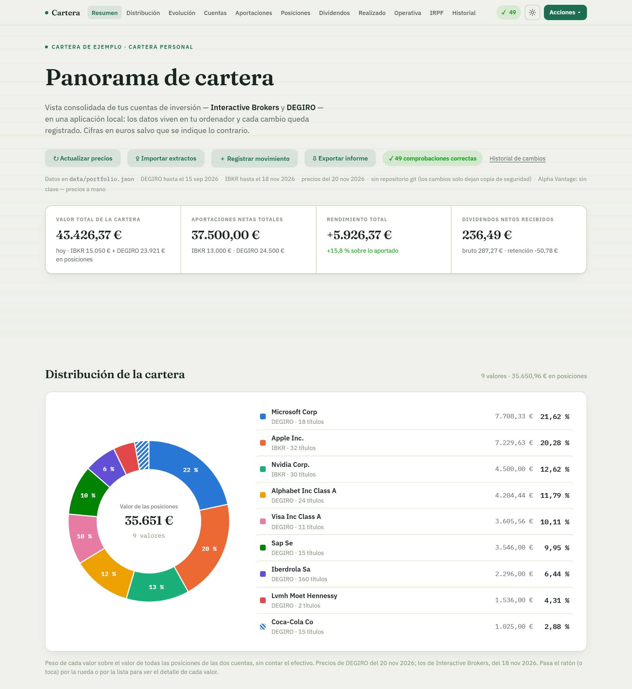
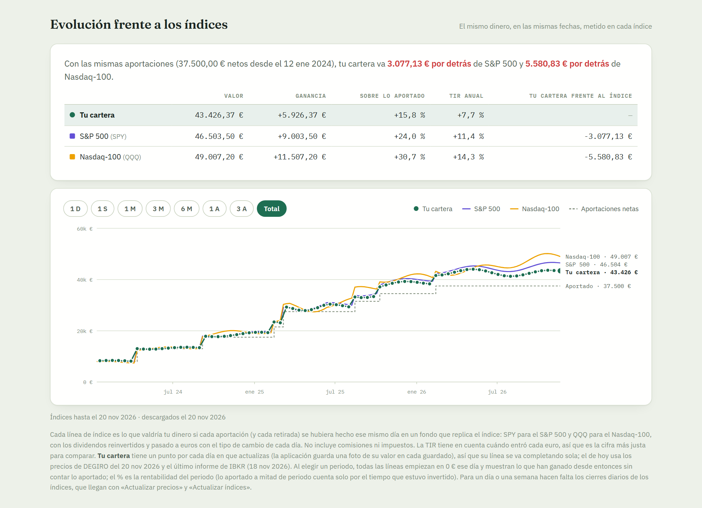
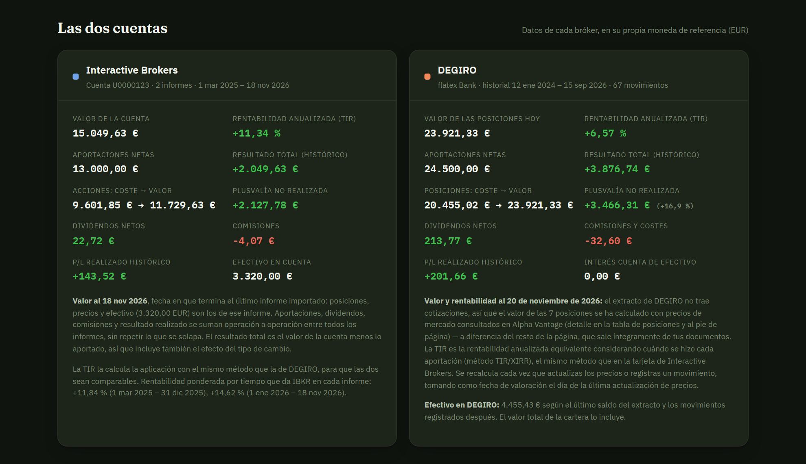
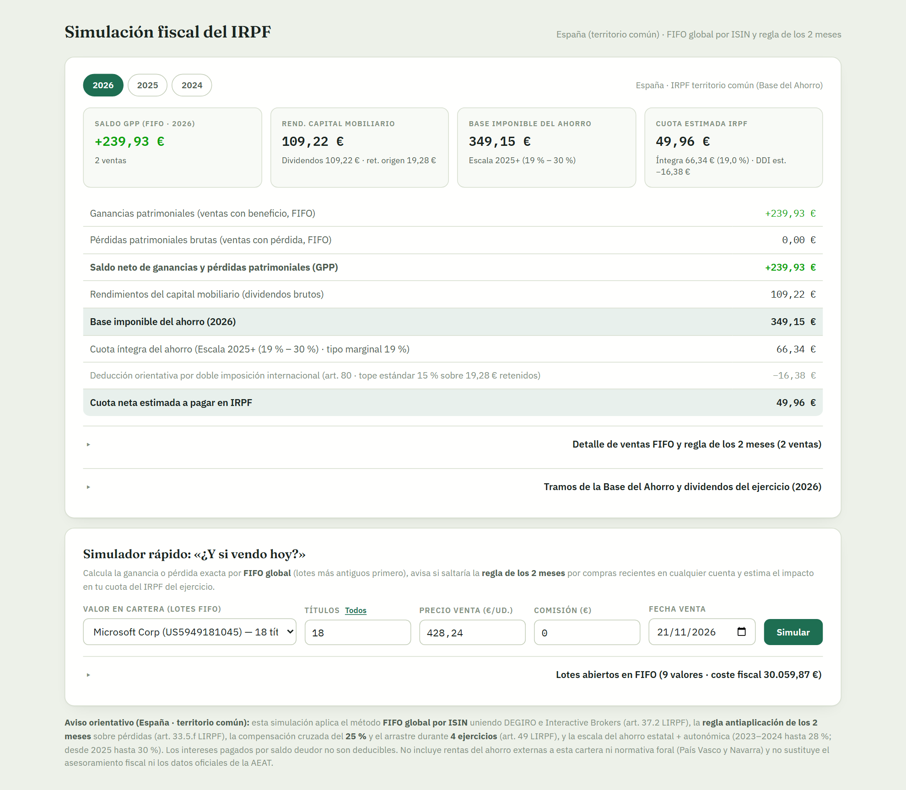

# Panorama de Cartera

> **Panel local y privado para seguir tu cartera de inversión en DEGIRO e Interactive Brokers:** valor total, aportaciones, rentabilidad anualizada (TIR), dividendos, resultado realizado, comparación con S&P 500 / Nasdaq-100 y simulación fiscal del IRPF (España).


**Tus datos no salen nunca de tu ordenador.** La aplicación se ejecuta en local (`http://localhost:8765`), guarda tu cartera en un archivo de la propia carpeta (`data/portfolio.json`), no requiere crear cuenta ni servidor externo y funciona incluso sin conexión a internet.

---

<p align="center">
  
</p>

<sub>*Todas las capturas de este documento utilizan una cartera ficticia de demostración con datos inventados.*</sub>

---

## Índice

- [Qué incluye](#qué-incluye)
- [Capturas de ejemplo](#capturas-de-ejemplo)
- [Instalación y arranque en 2 minutos](#instalación-y-arranque-en-2-minutos)
- [Guía de uso paso a paso](#guía-de-uso-paso-a-paso)
  - [1. Exportar e importar extractos](#1-exportar-e-importar-extractos)
  - [2. Actualizar precios (a mano o con Alpha Vantage)](#2-actualizar-precios-a-mano-o-con-alpha-vantage)
  - [3. Compararte con los índices](#3-compararte-con-los-índices)
  - [4. Registrar movimientos a mano](#4-registrar-movimientos-a-mano)
  - [5. Simulación fiscal del IRPF (España)](#5-simulación-fiscal-del-irpf-españa)
  - [6. Exportar informes (HTML, PDF y Markdown)](#6-exportar-informes-html-pdf-y-markdown)
- [Actualizar a una nueva versión sin perder datos](#actualizar-a-una-nueva-versión-sin-perder-datos)
- [Copia de seguridad automática con Git y GitHub (opcional)](#copia-de-seguridad-automática-con-git-y-github-opcional)
- [Preguntas frecuentes](#preguntas-frecuentes)
- [Límites conocidos](#límites-conocidos)
- [Documentación técnica](#documentación-técnica)

---

## Qué incluye

- **Una cuenta o las dos:** funciona con **DEGIRO**, con **Interactive Brokers** o combinando ambas (lo que no aplica a tu bróker se oculta automáticamente).
- **Consolidación real sin duplicados:** importa los CSV directamente desde tu bróker; puedes volver a subir periodos solapados sin duplicar apuntes, y la aplicación detecta automáticamente si falta algún tramo intermedio.
- **Rentabilidad justa (TIR / XIRR):** calcula la rentabilidad anualizada teniendo en cuenta exactamente cuándo entró y salió cada euro, tanto en total como por bróker.
- **Comparación con S&P 500 y Nasdaq-100:** simula cuánto valdría tu dinero si hubieras metido cada aportación y retirada el mismo día en SPY o QQQ (dividendos reinvertidos, en euros), con filtros `1D · 1S · 1M · 3M · 6M · 1A · 3A · Total`.
- **Simulación orientativa del IRPF (España, territorio común):** método **FIFO global por ISIN** uniendo DEGIRO e IBKR, regla antiaplicación de los 2 meses sobre pérdidas, compensación del 25 % con dividendos, arrastre a 4 años, escala del ahorro y simulador **«¿Y si vendo hoy?»**.
- **Tema claro y oscuro**, diseño adaptable a móvil y navegador de escritorio.
- **Comprobaciones automáticas e historial con deshacer:** cerca de 50 validaciones de coherencia en cada guardado, copias de seguridad automáticas en `data/backups/` y botón para deshacer el último cambio.
- **Exportación de informes:** genera un informe completo en HTML autónomo, PDF (impresión directa) o texto Markdown listo para archivar o analizar con una IA (ocultando nombre y número de cuenta por defecto).

---

## Capturas de ejemplo

### Evolución frente a los índices (S&P 500 y Nasdaq-100)
Compara tu cartera real frente a haber aportado exactamente las mismas cantidades en las mismas fechas a cada índice, en euros y con dividendos reinvertidos:



### Desglose por bróker y tema oscuro
Cada cuenta se presenta con su valoración, aportaciones, TIR, dividendos, comisiones, resultado realizado y efectivo — con selector de modo claro y oscuro integrado en la barra superior:



### Simulación fiscal del IRPF (España) y «¿Y si vendo hoy?»
Calcula por ejercicio la Base Imponible del Ahorro aplicando FIFO global entre brókers, controla la regla de los 2 meses y te permite simular una venta antes de ejecutarla:



---

## Instalación y arranque en 2 minutos

No necesitas instalar nada previamente ni tener conocimientos técnicos. Si tu ordenador no tiene **Node.js 18+**, el propio lanzador descarga automáticamente una copia oficial y portable dentro de la carpeta `.runtime/node/` (verificada con SHA-256 desde `nodejs.org`, sin permisos de administrador y sin modificar tu sistema).

1. **Descarga el archivo ZIP** desde la última versión en [**Releases**](https://github.com/peterfur/panorama-cartera-publico/releases).
2. **Descomprímelo** en la carpeta donde quieras guardar tu cartera (por ejemplo, `Documentos\panorama-cartera`).
3. **Abre la aplicación:**

| Sistema | Cómo arrancar |
| --- | --- |
| **Windows** | Doble clic en `iniciar.bat` |
| **macOS** | Doble clic en `iniciar.command` |
| **Linux** | `./iniciar.command` desde una terminal en esa carpeta |
| **Cualquiera (con Node.js)** | `npm start` desde una terminal en esa carpeta |

Se abrirá automáticamente tu navegador en `http://localhost:8765` con la pantalla de bienvenida lista para importar tus extractos. Para cerrar la aplicación, cierra la ventana de consola o pulsa `Ctrl+C`.

> **Avisos normales la primera vez que abres un ZIP descargado de internet:**
> - **Windows:** si aparece la pantalla azul de Windows SmartScreen (*«Windows protegió su PC»*), pulsa **Más información → Ejecutar de todas formas**.
> - **macOS:** si el sistema bloquea `iniciar.command`, haz clic derecho sobre el archivo → **Abrir** (o ejecuta `chmod +x iniciar.command` en Terminal).
> - **Conexión a internet:** solo hace falta la primera vez si tu equipo no tenía Node.js (para bajar la copia portable oficial). Después, la aplicación funciona completamente sin conexión.

---

## Guía de uso paso a paso

### 1. Exportar e importar extractos

Al abrir la aplicación por primera vez verás el botón **«Importar extractos»**. Exporta los archivos siempre en **CSV** y con la web de tu bróker en **español**:

| Bróker | Dónde descargar el CSV | Qué fechas elegir |
| --- | --- | --- |
| **DEGIRO** | `Actividad → Estado de cuenta → Exportar → CSV` | La primera vez, desde la apertura de tu cuenta hasta hoy. En futuras actualizaciones, cualquier tramo que empiece **antes** de la última fecha ya importada. |
| **Interactive Brokers** | `Rendimiento e informes → Extractos → Actividad → CSV` | IBKR permite como máximo 1 año por informe: descarga un informe por año desde la apertura hasta el año en curso y súbelos todos a la vez. |

**Cómo funciona la importación:**
- Puedes arrastrar o seleccionar uno o varios CSV a la vez (de DEGIRO, de IBKR o de ambos).
- **Vista previa antes de guardar:** te enseña qué apuntes son nuevos y cómo cambian tus cifras antes de confirmar.
- **Sin duplicados ni huecos:** si las fechas se solapan con una importación anterior, solo añade lo nuevo; si falta un periodo intermedio, avisa y bloquea la importación hasta que subas el tramo faltante.
- **Todo se recalcula desde el libro completo** (`data/degiro-movimientos.csv` y `data/ibkr-extractos.json`), por lo que el orden en que importes los archivos no altera los resultados.

Los CSV originales descargados del bróker no hace falta conservarlos después de importar (si quieres guardarlos en la carpeta `extractos/`, git los ignora automáticamente).

---

### 2. Actualizar precios (a mano o con Alpha Vantage)

El extracto de Interactive Brokers ya incluye el precio de cierre de tus posiciones, pero el **extracto de DEGIRO no incluye cotizaciones de mercado** (tras la primera importación valora cada acción a su último precio de compra/venta hasta que actualices precios).

Pulsa **«Actualizar precios»** para actualizar las cotizaciones de DEGIRO y los tipos de cambio:

- **A mano (sin clave y sin internet):** rellena las casillas de precio y tipo de cambio y pulsa Guardar.
- **Automático y gratuito con Alpha Vantage:**
  1. Consigue una clave gratuita en <https://www.alphavantage.co/support/#api-key>.
  2. Pégala dentro de **«Actualizar precios»** y pulsa **Guardar clave** (o escríbela directamente en el archivo `.env` de la carpeta en `ALPHAVANTAGE_API_KEY=TU_CLAVE`).
  3. El plan gratuito permite unas 25 consultas al día (1 por divisa en `autoFx`, 1 por valor con símbolo y 3 opcionales para cierres diarios de índices). Si se agota el cupo o una bolsa no está cubierta, la ventana te deja completar a mano las casillas pendientes.

Puedes configurar qué símbolo de bolsa consulta Alpha Vantage para cada ISIN editando `config.json`:

```json
"US5949181045": { "symbol": "MSFT", "cur": "USD", "label": "Nasdaq: MSFT" }
```

- `cur` es la divisa en la que cotiza **ese símbolo** (útil si prefieres consultar un valor europeo en su cotización del Nasdaq en USD).
- Para bolsas europeas, Alpha Vantage utiliza sufijos como `.AMS` (Ámsterdam), `.DEX` (Xetra) o `.FRK` (Fráncfort).

---

### 3. Compararte con los índices

En la sección **«Evolución frente a los índices»**, pulsa **«Actualizar índices»** para descargar el histórico semanal ajustado (con dividendos reinvertidos) y los cierres diarios recientes en `data/indices.json` (requiere clave de Alpha Vantage la vez que actualices; después funciona sin conexión).

- Por defecto compara contra **S&P 500 (`SPY`)** y **Nasdaq-100 (`QQQ`)**, pero puedes personalizar o añadir índices (por ejemplo MSCI World con `URTH`) en el campo `benchmarks` de `config.json`:
  ```json
  "benchmarks": [
    { "id": "sp500", "name": "S&P 500", "symbol": "SPY", "cur": "USD" },
    { "id": "msci", "name": "MSCI World", "symbol": "URTH", "cur": "USD" }
  ]
  ```
- La línea de **Tu cartera** se va construyendo automáticamente con un punto por cada día en que guardas cambios (actualizaciones de precios o importaciones).

---

### 4. Registrar movimientos a mano

Con **«Registrar movimiento»** puedes apuntar compras, ventas, dividendos, aportaciones, retiradas, comisiones o intereses recientes de DEGIRO sin esperar al siguiente extracto. Cuando más adelante importes un CSV que incluya esa fecha, el apunte manual queda sustituido automáticamente por el oficial del bróker sin contarse dos veces.

---

### 5. Simulación fiscal del IRPF (España)

La sección **«Simulación fiscal del IRPF»** ofrece una estimación orientativa para contribuyentes de **territorio común en España**:

- Aplica el método **FIFO global por ISIN** uniendo todas las compras y ventas de DEGIRO e Interactive Brokers.
- Controla la **regla antiaplicación de los 2 meses** sobre pérdidas con recompras homogéneas (art. 33.5.f LIRPF), avisando de pérdidas bloqueadas y cuándo se liberan.
- Aplica la **compensación cruzada del 25 %** entre ganancias/pérdidas patrimoniales y rendimientos del capital mobiliario (dividendos), el arrastre durante 4 ejercicios y las escalas del ahorro (2023–2024 y 2025+).
- Incluye el simulador **«¿Y si vendo hoy?»** para calcular antes de vender qué lotes FIFO saldrían, el beneficio/pérdida fiscal y el impacto en tu cuota.

> *Aviso: el cálculo es orientativo y no sustituye los datos fiscales oficiales de la AEAT ni el asesoramiento profesional (no incluye rentas externas a la cartera ni regímenes forales de País Vasco o Navarra).*

---

### 6. Exportar informes (HTML, PDF y Markdown)

El botón **«Exportar informe»** genera un resumen completo de toda la cartera (resumen, posiciones, exposición por divisa, dividendos, resultado realizado, aportaciones, costes, operativa, simulación IRPF y opcionalmente todas las operaciones):

- **HTML:** archivo único autónomo sin recursos externos.
- **PDF:** impresión limpia desde el navegador (*Guardar como PDF*).
- **Markdown:** texto estructurado listo para copiar y pegar en un chat con IA.

Por defecto oculta tu nombre y número de cuenta; los ISIN, importes y fechas sí se incluyen.

---

## Actualizar a una nueva versión sin perder datos

Cuando salga una nueva versión en [**Releases**](https://github.com/peterfur/panorama-cartera-publico/releases):

1. Descarga y descomprime el nuevo ZIP.
2. **Conserva estos archivos/carpetas de tu carpeta anterior:**
   - `data/` *(toda tu cartera, libros de extractos, índices y backups)*
   - `config.json` *(tu titular, símbolos de Alpha Vantage y ajustes)*
   - `.env` *(tu clave de Alpha Vantage y puerto)*
   - `.runtime/` *(opcional, para no volver a descargar Node.js portable)*
3. Sustituye el resto de archivos del programa por los de la nueva versión y vuelve a abrir `iniciar.bat` / `iniciar.command`.

---

## Copia de seguridad automática con Git y GitHub (opcional)

Si quieres llevar un historial automático de cada cambio en un **repositorio privado tuyo** de GitHub:

1. Instala [Git](https://git-scm.com/downloads).
2. Crea en <https://github.com/new> un repositorio **privado** y **vacío** (sin README, sin `.gitignore` y sin licencia).
3. En Windows, haz doble clic en `configurar-git.bat` y pega la URL de tu repositorio cuando la pida (en macOS/Linux, inicializa con `git init -b main && git add -A && git commit -m "Inicio" && git remote add origin <URL> && git push -u origin main`).

A partir de ahí, cada guardado en la app crea un commit descriptivo con tus datos (`data/portfolio.json`, libros de extractos y `config.json`), **sin subir nunca `.env`** (tu clave está protegida en `.gitignore`). Con `"autoPush": true` en `config.json` también se suben solos; con `"autoCommit": false` se desactiva la integración con git.

---

## Preguntas frecuentes

**¿Se envían mis extractos o mi cartera a algún servidor?**
No. Todo se calcula y guarda en tu ordenador. El servidor solo escucha en `127.0.0.1` (inaccesible desde fuera de tu equipo). Las únicas conexiones a internet posibles son: (1) la descarga única de Node.js LTS oficial desde `nodejs.org` si no lo tenías, (2) consultas de cotizaciones a Alpha Vantage si introduces una clave, y (3) `git push` si configuras tu propio repositorio privado.

**¿El puerto `8765` ya está en uso en mi ordenador?**
Abre `.env` y cambia `PORT=8765` por otro número libre (por ejemplo `PORT=8766`).

**¿Me he equivocado al registrar un movimiento o importar un archivo?**
Pulsa **«Deshacer el último cambio»** en la sección Historial: cada guardado deja una copia exacta del estado anterior en `data/backups/`.

**¿Puedo pasar la app a otra persona sin que lleve mis datos?**
Sí: haz doble clic en `crear-copia-para-compartir.bat` (o ejecuta `npm run copia`). Creará una carpeta limpia al lado sin `data/`, sin tu `.env` y sin tu configuración, lista para comprimir y compartir.

---

## Límites conocidos

- **Extractos en español y en formato CSV:** si la web de DEGIRO o IBKR está en otro idioma, cambian las cabeceras de columna y la app avisará de que no reconoce el formato.
- **Divisa base de Interactive Brokers:** diseñada para cuentas con divisa base en euros (`EUR`).
- **Tipos de apuntes inusuales en DEGIRO:** si DEGIRO introduce una operación corporativa no contemplada (cambio de ISIN, derechos, splits), se muestra un aviso al importar y en las comprobaciones. En IBKR los splits sí quedan reflejados en las posiciones del informe.
- **Dividendos en otra divisa en DEGIRO:** se convierten a euros con el tipo de cambio exacto de su conversión en el extracto; si aún no se ha convertido al cerrar el archivo, se marcan con `≈` hasta la siguiente importación.

---

## Documentación técnica

Para detalles de arquitectura, modelo de datos, fórmulas de cálculo, seguridad local y estructura de archivos, consulta [DOCUMENTACION-TECNICA.md](DOCUMENTACION-TECNICA.md).
